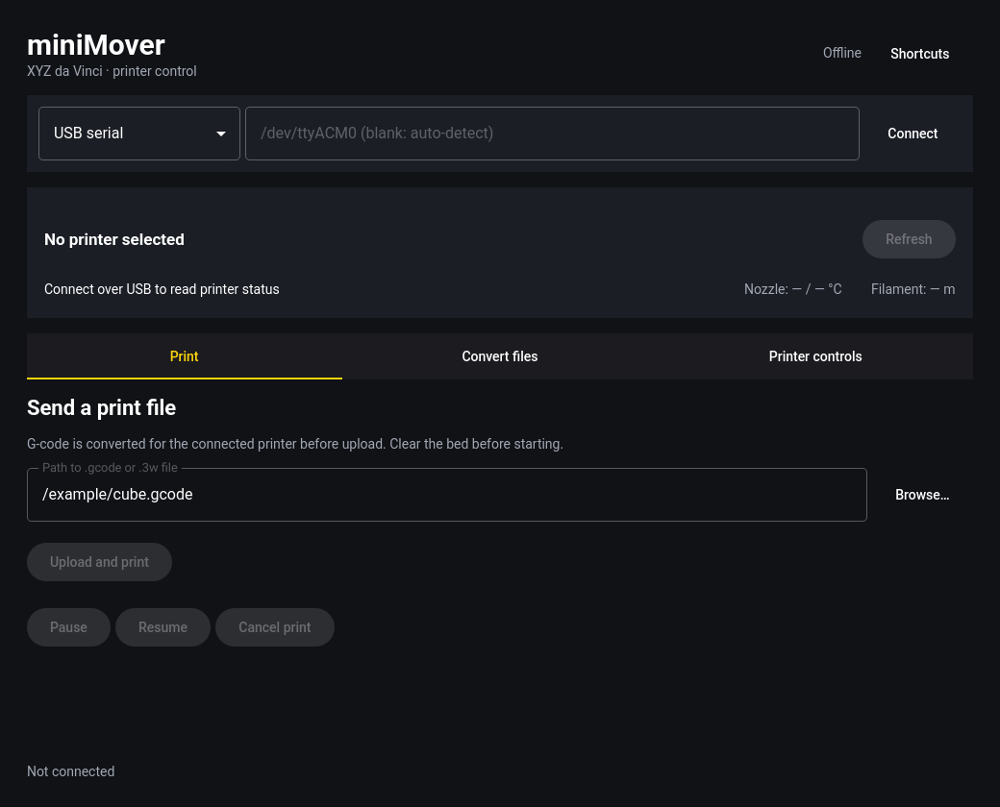

# miniMover for Linux

A native C++ / Qt 6 Quick interface sharing the original miniMover printer library. No Python runtime or duplicate protocol implementation is required. The existing Windows UI is unchanged.

## Build and run

Requires a C/C++ compiler, make, Qt 6 base, declarative / Quick Controls, SVG, and Wayland modules. A working xdg-desktop-portal backend provides native file pickers; paths can also be entered manually.

```sh
./miniMoverQt/bin/build
./miniMoverQt/build/minimover-qt
```

On Arch/Omarchy the development packages are `base-devel qt6-base qt6-declarative qt6-svg qt6-wayland`. To build and install an Arch package and app-launcher entry explicitly:

```sh
./miniMoverQt/bin/install
```

## Use

- **Connect:** choose USB serial, enter a device such as `/dev/ttyACM0`, then Connect. Blank input scans serial ports, which can open unrelated serial devices; an explicit device is recommended. Check the device's group/permissions if access is denied; do not run the UI as root.
- **Status:** model, printer state, nozzle temperature, remaining filament, and print progress refresh every five seconds.
- **Print:** select a `.gcode` or `.3w` file, clear the bed, then confirm Upload and print. Pause, resume, and cancel are available while monitoring. Disconnecting or closing monitoring does not cancel a print.
- **Convert:** works offline. Select the exact target model for G-code → `.3w`, and a new output filename. Conversion writes through a temporary file and atomic save; existing outputs and originals are not overwritten.
- **Controls:** homing, small axis jogs, filament loading/unloading, bed calibration, nozzle cleaning, auto-level, and buzzer. Manual steps appear with a Continue button. These controls are restricted to printers without an LCD tuning menu and locked while printing.

The UI stays responsive because printer I/O and conversion run on a dedicated thread. Closing is blocked during an operation so an upload is not silently interrupted. Firmware updates, camera capture, and Wi-Fi configuration remain in the original tools; they are not exposed by this initial Linux UI. Wi-Fi transport is experimental, just as in the original project.

The legacy library limits conversion/print paths to 259 bytes and G-code lines to 1022 characters. Unsupported or malformed files fail with an in-window error. Printer hardware and Windows-specific changes require testing on those platforms; automated tests use local sockets and pseudo-terminals, not a real printer.

## Keyboard

Shortcuts do not intercept normal text entry.

| Key | Action |
| --- | --- |
| Ctrl+O | Choose print file |
| Ctrl+R / Space | Refresh status |
| ? | Show shortcuts |
| Q | Quit, with confirmation while monitoring |

The accent and window rounding follow Omarchy live, with a yellow/sharp-corner fallback elsewhere. The language file is watched read-only; bundled Danish and Czech translations fall back to English for untranslated text. No desktop configuration is modified.

## Headless conversion

```sh
./miniMoverQt/build/minimover-qt models --json
./miniMoverQt/build/minimover-qt convert input.gcode output.3w --model 12 --json
./miniMoverQt/build/minimover-qt convert input.3w output.gcode --json
./miniMoverQt/build/minimover-qt skill install ./agent-skills/minimover --json
```

Commands need no display and return 0 on success or 1 on failure. `--json` emits structured results, with errors on stderr. Skill installation is opt-in and requires an explicit destination.

## Tests

```sh
./miniMoverQt/bin/test
```

Tests cover stream boundaries, partial/interrupted socket sends, closed peers, serial raw mode/reopening, padding validation, command preservation, round trips across every registered model, malformed files, atomic conversion, theme/language changes, and real QML interaction offscreen.

License: [MIT](../docs/LICENSE). Theme/language watching follows the patterns of Omacut and Monologue (MIT, David Heinemeier Hansson).
